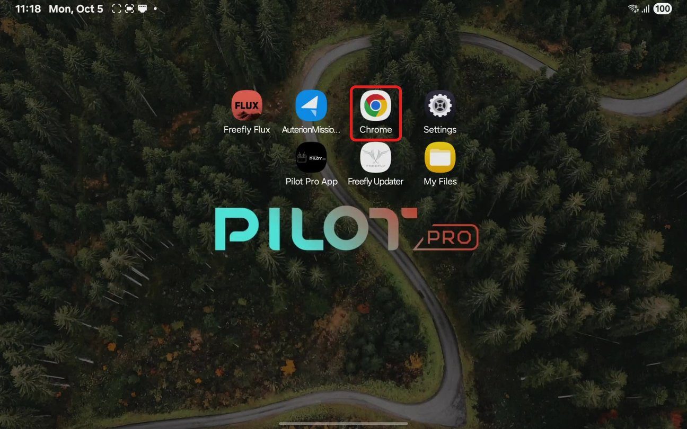
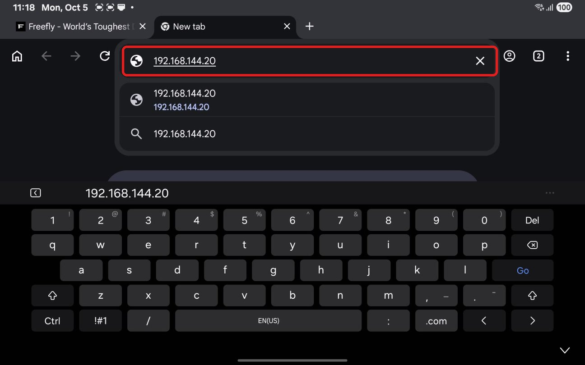
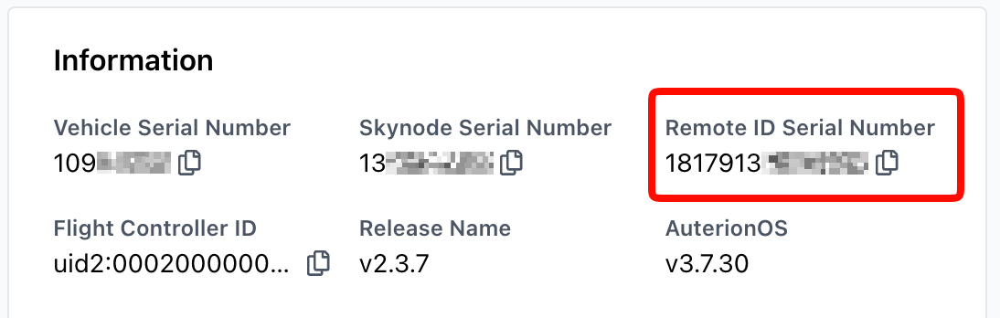
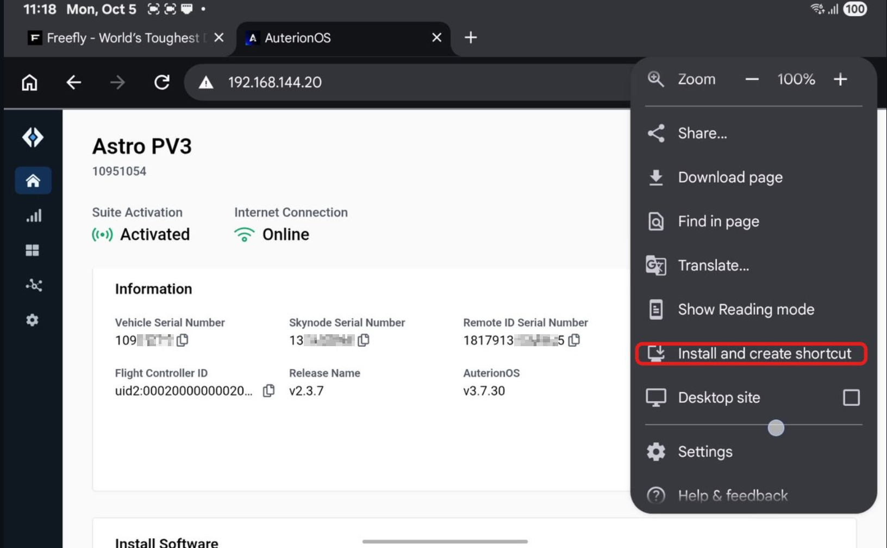

# Compliance

## FAA Remote Identification (RID)

Alta X Gen2 comes with Standard Remote ID built in.

To register your Alta X Gen2 with the FAA, you need its Remote ID Serial Number, a number that starts with **18179**. The quickest way to find it is from the Chrome browser on your Pilot Pro, with no laptop or USB cable needed.


You may have seen instructions that connect the drone to a computer over USB and open 10.41.1.1. That works, but company-managed computers have been known to block USB network devices, so the Pilot Pro method below is our recommended workflow.


### Find your Remote ID Serial Number



### Power on Alta X Gen2 and Pilot Pro.

Wait for them to fully boot and connect. The LED on the Pilot Pro power button should be <mark style="color:$success;">**green**</mark>, indicating the radio modules are paired.



### Open Google Chrome

If you don't have it on your tablet home page, swipe up from the center of the screen to access all your apps. It will be nested under the "Google" folder. You can also use any other browser you wish.




### Navigate to AuterionOS

Tap the address bar, type `192.168.144.20`, then tap **Go**.


Connection to the internet is not required for this step. This is connecting you directly to the Skynode onboard the aircraft.





### Copy your Remote ID Serial Number

The drone's page loads in a tab labeled AuterionOS (it can take a few seconds). Under **Information** at the top, find **Remote ID Serial Number**. It starts with **18179**. You can tap the copy icon next to it to copy it.


Note: Earlier firmware may not have the **Remote ID Serial Number**. In that case, locate the **Skynode Serial Number** (e.g., 132000209) and add the **18179** prefix to get your Remote ID Serial Number (e.g., 18179132000209). The 18179 prefix identifies your aircraft to the FAA as made by Freefly Systems.


<figure><figcaption></figcaption></figure>


Alternative to Pilot Pro: You can also access the AuterionOS page by connecting your aircraft to a computer via USB. Then open a browser on the computer to `10.41.1.1`




### Register with the FAA

Enter this number as the Remote ID serial number when you register your Alta X Gen2 on the [FAA DroneZone](https://faadronezone-access.faa.gov/) website.

* Log in or create an account
* Select **Drone Owners and Pilots Dashboard**
* Select **Manage Device Inventory**, then **Add Device**



### Affix a label to your drone

The Remote ID rule requires Standard Remote ID aircraft to display a label indicating the drone complies with the rule. Print a label that reads "FAA Standard Remote ID Compliant" and use tape or adhesive to securely affix it to your drone. The label must be in English and be legible, prominent, and permanently affixed to the aircraft.



### Tip: add a home screen shortcut

You can save this page as an icon on the Pilot Pro home screen, so next time it's one tap instead of typing the address. With the page open in Chrome, tap the **⋮** menu in the top right, then tap **Install and create shortcut**. You may need to scroll down in the menu to see it.

